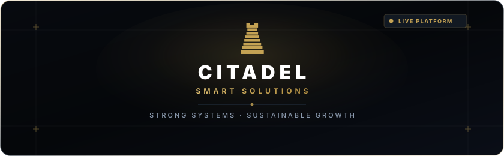

<p align="center">
  <a href="https://citadel-solution.vercel.app/" target="_blank" rel="noopener noreferrer">
    
  </a>
</p>

<h1 align="center">Citadel Smart Solutions</h1>

<p align="center">
  <strong>Strong Systems. Sustainable Growth.</strong><br>
  Official web platform and digital experience for Citadel Smart Solutions — engineering custom operational engines, automation infrastructure, and scalable digital products built directly around how modern businesses operate.
</p>

<p align="center">
  <a href="https://citadel-solution.vercel.app/"></a>
  <a href="https://nextjs.org/"></a>
  <a href="https://react.dev/"></a>
  <a href="https://tailwindcss.com/"></a>
  <a href="https://gsap.com/"></a>
  <a href="https://threejs.org/"></a>
  <a href="https://www.typescriptlang.org/"></a>
</p>

<p align="center">
  <a href="#-live-production-url">Live URL</a> •
  <a href="#️-philosophy--architecture">Philosophy</a> •
  <a href="#-core-features">Core Features</a> •
  <a href="#️-tech-stack">Tech Stack</a> •
  <a href="#-brand-assets--identity">Brand Assets</a> •
  <a href="#-project-structure">Project Structure</a> •
  <a href="#-design-system--brand-palette">Design System</a> •
  <a href="#-getting-started">Getting Started</a>
</p>

---

## 🌐 Live Production URL

- **Production URL:** [https://citadel-solution.vercel.app/](https://citadel-solution.vercel.app/)
- **Repository:** [https://github.com/citadel-eg/citadel](https://github.com/citadel-eg/citadel)

---

## 🏛️ Philosophy & Architecture

Citadel Smart Solutions approaches technology from the inside out: **understanding business operations first**, then engineering custom digital systems and automation to streamline workflows, eliminate friction, and scale operations securely.

The platform embodies this philosophy through an **architectural, restrained aesthetic**:
- **Monolithic 3D Centerpiece:** Custom WebGL/Three.js interactive Citadel tower symbolising tiered, indestructible foundations.
- **Architectural Shutter Page Transitions:** Synchronous GSAP shutter overlays that assemble and deconstruct the Citadel mark during client-side navigation.
- **Micro-Interactions & Smooth Momentum:** Integrated Lenis smooth scroll combined with GSAP ScrollTrigger timeline choreography.
- **Restrained Luxury Palette:** Deep space navy (`#05070A`), structural graphite (`#1C2633`), clean hairline dividers, and sparing Citadel gold (`#C4A254`) accents.

---

## ⚡ Core Features

### 1. Pinned 3D Citadel Architecture Journey
- Unified Three.js / WebGL 3D architectural tower that seamlessly transitions across 8 stages of the business methodology.
- Synchronized camera flight timeline mapped to the core business statements.
- Directional touch-filtering (`touch-pan-y`) ensuring mobile thumb-scrolling remains smooth while still supporting interactive 3D drag manipulation.
- Floating volumetric particle field with ambient lighting effects.

### 2. Interactive Project Scope & Investment Estimator
- Real-time client scope calculator supporting multi-phase selection (System Architecture, Automations, Enterprise Web Applications, Dedicated Integrations).
- Dynamic tier calculation, timeline forecasting, and direct handoff to consultation booking.

### 3. Panoramic Case Study Showcases
- High-fidelity case study viewer featuring the **Galaxy Store** multi-channel commerce platform.
- Interactive panoramic projection with responsive stacked HUD breakdowns for mobile devices and wide-gamut desktop screens.

### 4. Direct Discovery Consultation Scheduler
- Integrated multi-step booking engine for prospective partners.
- 5-column responsive date picker with UTC+2 Cairo timezone awareness.
- Instant calendar invitation generation (`.ics` download), WhatsApp direct confirmation, and Google Meet scheduling.

### 5. Dedicated Route Architecture
- **`/services`**: Comprehensive service architecture breakdowns (Operational Engines, Intelligent Automation, Bespoke Web Platforms), operational workflows, and delivery framework.
- **`/work`**: Case study portfolio, Galaxy Store deep-dive, and live system metrics.
- **`/company`**: Operating principles, engineering ethos, leadership profile, and system guarantees.
- **`/contact`**: Dedicated booking gateway, direct WhatsApp channel, and inquiries.
- **`/get-started`**: Direct intake funnel routing directly into the consultation scheduler.

### 6. Architectural Shutter Page Transitions & Preloader
- Tier-by-tier SVG assembly preloader (`CitadelPreloader`).
- Zero layout-shift 4-column shutter transitions between routes powered by `@gsap/react` and `useGSAP`.
- Global inertial smooth scrolling powered by Lenis 1.3.

### 7. Search Engine Optimization (SEO) & Web Standards
- Next.js App Router dynamic `robots.ts` (`/robots.txt`) and `sitemap.ts` (`/sitemap.xml`).
- Comprehensive OpenGraph & Twitter `summary_large_image` cards for every route.
- Schema.org JSON-LD structured data graph (`Organization` & `WebSite`).
- Multi-resolution SVG, ICO, and Apple Touch Icon favicons.

---

## 🛡️ Brand Assets & Identity

<p align="center">
  <picture>
    <source media="(prefers-color-scheme: dark)" srcset="./public/citadel-logo-dark.svg">
    <source media="(prefers-color-scheme: light)" srcset="./public/citadel-logo-light.svg">
    
  </picture>
</p>

The Citadel mark represents an 8-tier architectural monolith — ascending from immovable foundational systems (Tier 1) through operational layers up to the crenelated crown (Tier 8).

| Asset | File Path | Format | Usage |
|---|---|---|---|
| **Header Banner** | [`public/citadel-banner.svg`](./public/citadel-banner.svg) | SVG (Vector) | README header, social previews, showcase banners |
| **Horizontal Logo (Adaptive)** | [`public/citadel-logo.svg`](./public/citadel-logo.svg) | SVG (Vector) | Header lockups, documentation, adaptive light/dark |
| **Dark Theme Logo** | [`public/citadel-logo-dark.svg`](./public/citadel-logo-dark.svg) | SVG (Vector) | High-contrast white typography on dark backdrops |
| **Light Theme Logo** | [`public/citadel-logo-light.svg`](./public/citadel-logo-light.svg) | SVG (Vector) | High-contrast graphite typography on light backdrops |
| **Vector Tower Mark** | [`public/citadel-mark.svg`](./public/citadel-mark.svg) | SVG (Vector) | Standalone 8-tier architectural rook mark |
| **App Favicon** | [`app/icon.svg`](./app/icon.svg) | SVG (Vector) | Browser tabs, bookmarks (64x64 gold mark on dark tile) |
| **Apple Touch Icon** | [`app/apple-icon.png`](./app/apple-icon.png) | PNG | iOS Home Screen bookmark icon (180x180) |

---

## 🛠️ Tech Stack

| Layer | Technology |
|---|---|
| **Framework** | [Next.js 16 (App Router)](https://nextjs.org/) |
| **Language** | [TypeScript 5](https://www.typescriptlang.org/) |
| **UI Library** | [React 19](https://react.dev/) |
| **Styling** | [Tailwind CSS v4](https://tailwindcss.com/) |
| **Animation** | [GSAP 3.15](https://gsap.com/) & [@gsap/react](https://www.npmjs.com/package/@gsap/react) |
| **3D & WebGL** | [Three.js 0.186](https://threejs.org/) & [OGL](https://github.com/oframe/ogl) |
| **Smooth Scrolling** | [Lenis 1.3](https://github.com/darkroomengineering/lenis) |
| **Typography** | [Inter](https://fonts.google.com/specimen/Inter) |
| **Deployment** | [Vercel](https://vercel.com/) |

---

## 📁 Project Structure

```
citadel/
├── app/
│   ├── layout.tsx             # Root layout: SEO metadataBase, fonts, JSON-LD, providers
│   ├── page.tsx               # Homepage: 3D journey, problem review, what we build, estimator
│   ├── globals.css            # Tailwind v4 theme, design tokens, typography rules
│   ├── icon.svg               # Vector SVG favicon (Citadel gold mark on dark tile)
│   ├── apple-icon.png         # 180x180 Apple touch icon
│   ├── favicon.ico            # Multi-size ICO favicon
│   ├── robots.ts              # Dynamic robots.txt generation
│   ├── sitemap.ts             # Dynamic sitemap.xml generation
│   ├── company/
│   │   └── page.tsx           # Company philosophy, leadership, and operating rules
│   ├── contact/
│   │   └── page.tsx           # Contact hero and discovery consultation booking
│   ├── get-started/
│   │   └── page.tsx           # Dedicated intake redirect
│   ├── services/
│   │   └── page.tsx           # What We Build, How We Work, Growth Model
│   └── work/
│       └── page.tsx           # Selected Work, Galaxy Store case study, project gallery
├── components/
│   ├── CitadelLogo.tsx        # Official CitadelLogo & CitadelMark vector components
│   ├── Citadel3DModel.tsx     # WebGL 3D Citadel tower with touch-safe gestures
│   ├── Citadel3DPlaceholder.tsx # Progressive loading 3D placeholder
│   ├── CitadelPreloader.tsx   # Initial tier-by-tier SVG preloader
│   ├── PageTransition.tsx     # 4-column architectural shutter page transitions
│   ├── SmoothScrollProvider.tsx # Lenis smooth scroll controller
│   ├── Header.tsx             # Fixed responsive navigation with mobile drawer
│   ├── FooterCTA.tsx          # Grand CTA with watermark tower silhouette
│   ├── HeroStatements.tsx     # Pinned 3D journey across 8 architectural statements
│   ├── BusinessFirst.tsx      # Step-by-step business analysis breakdown
│   ├── ProblemSection.tsx     # 3-card operational review
│   ├── WhatWeBuild.tsx        # Capabilities grid (Automation, Operations, Products)
│   ├── ApproachSection.tsx    # 5 ascending engineering layers
│   ├── ProjectEstimator.tsx   # Interactive scope, timeline & cost estimator
│   ├── CaseStudy.tsx          # 3D interactive case study panorama (Galaxy Store)
│   ├── CircularCarousel.tsx   # Circular portfolio navigation
│   ├── ProjectGallery.tsx     # Project card showcase
│   ├── ScheduleConversation.tsx # Booking coordinator
│   ├── company/               # Sub-sections for /company (CompanyHero, CompanySections)
│   ├── contact/               # Sub-sections for /contact (ContactHero, ContactBookingSection)
│   ├── schedule/              # SessionPicker, BookingForm, BookingConfirmed, ICS generator
│   ├── services/              # Sub-sections for /services (ServicesSections)
│   └── work/                  # Sub-sections for /work (WorkSections)
├── lib/
│   ├── gsap.ts                # GSAP plugin registrations (ScrollTrigger, useGSAP)
│   ├── motion.ts              # Motion design tokens (durations, easings, distances)
│   └── intro-context.tsx      # First-visit preloader state management
├── public/
│   ├── citadel-banner.svg     # Official architectural header marquee banner
│   ├── citadel-logo.svg       # Adaptive vector horizontal logo
│   ├── citadel-logo-dark.svg  # Dark-mode optimized vector logo
│   ├── citadel-logo-light.svg # Light-mode optimized vector logo
│   ├── citadel-mark.svg       # Official Citadel vector rook/tower mark
│   ├── favicon.ico            # Static fallback favicon
│   └── galaxy-store.png       # Galaxy Store platform showcase image
├── DESIGN.md                  # Design system rules, token contracts, colors
├── COMPONENTS.md              # Component blueprints and recipes
├── MOTION.md                  # GSAP motion choreography standards
└── AGENTS.md                  # Coding and architectural guardrails
```

---

## 🎨 Design System & Brand Palette

Built strictly to the specifications in `DESIGN.md`:

| Token | Value | Role |
|---|---|---|
| `bg-surface-dark` | `#05070A` | Deep space background |
| `bg-surface-darker` | `#1C2633` | Secondary graphite background |
| `border-line` | `rgba(255, 255, 255, 0.15)` | Hairline structural dividers |
| `brand` / `gold` | `#C4A254` | Citadel signature accent (CTAs, tags, numbers) |
| `text-fg` | `#FFFFFF` | Primary text |
| `text-fg-muted` | `#8A99AD` | Subdued secondary text |

---

## 🚀 Getting Started

### Prerequisites
- **Node.js**: `v20.x` or later
- **npm** / **pnpm** / **yarn**

### Installation

1. **Clone the repository:**
   ```bash
   git clone https://github.com/citadel-eg/citadel.git
   cd citadel
   ```

2. **Install dependencies:**
   ```bash
   npm install
   ```

3. **Start the local development server:**
   ```bash
   npm run dev
   ```

4. **Open in browser:**
   Navigate to [http://localhost:3000](http://localhost:3000).

### Build & Production Testing

```bash
# Validate production bundle
npm run build

# Start production server
npm run start

# Run ESLint
npm run lint
```

---

## 🔍 SEO & Discovery

- **Robots Endpoint:** `/robots.txt`
- **Sitemap Endpoint:** `/sitemap.xml`
- **Canonical URL:** `https://citadel-solution.vercel.app`
- **Structured Data:** Schema.org `Organization` and `WebSite` JSON-LD graph.
- **Social Previews:** Optimized OpenGraph & Twitter Card previews for all pages.

---

## 📄 License & Credits

© 2026 **Citadel Smart Solutions**. All rights reserved.  
*Strong Systems. Sustainable Growth.*
